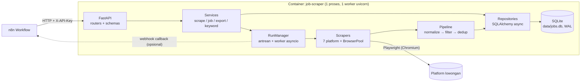
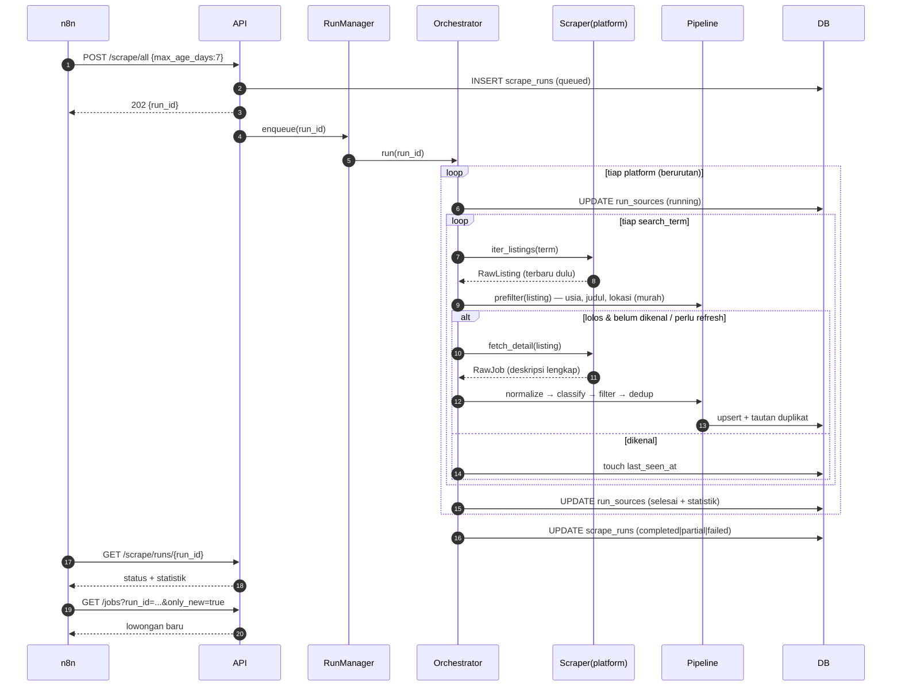

# ARCHITECTURE — Job Scraper API

> **Versi:** 1.0 · **Tanggal:** 1 November 2026
> **Dokumen terkait:** [`PRD.md`](./PRD.md) · [`DATABASE.md`](./DATABASE.md) · [`SCRAPER_SPEC.md`](./SCRAPER_SPEC.md)

Dokumen ini menjelaskan **struktur kode, komponen, alur data, kontrak API, konfigurasi, dan deployment**. Requirement produk ada di PRD; skema tabel ada di DATABASE; detail per platform ada di SCRAPER_SPEC.

---

## 1. Gambaran Umum



**Prinsip arsitektur**

1. **Layered & searah:** `api → services → (run manager / repositories)`. Scraper tidak boleh mengimpor layer `api`.
2. **Scraper hanya mengekstrak, pipeline yang memutuskan.** Scraper menghasilkan `RawJob` mentah; normalisasi, filter, dan dedup berada di `pipeline/` agar logikanya satu tempat dan mudah diuji tanpa browser.
3. **Satu penulis ke SQLite.** Semua penulisan lewat satu `RunManager` worker dan repository; API hanya membaca (kecuali CRUD kecil keyword/arsip, yang singkat).
4. **Kegagalan terisolasi per platform dan per lowongan.**
5. **Parser murni dipisah dari I/O browser** agar bisa diuji dengan fixture.
6. **Semua konfigurasi di luar kode** (env + `config/*.yaml`).

---

## 2. Tech Stack

| Kebutuhan | Pilihan | Catatan |
|-----------|---------|---------|
| Bahasa | Python **3.12** | |
| Web framework | **FastAPI** + **uvicorn** (`--workers 1`) | Worker harus 1 (SQLite + antrean in-process) |
| Validasi | **Pydantic v2** + **pydantic-settings** | |
| ORM | **SQLAlchemy 2.x (async)** + **aiosqlite** | |
| Migrasi | **Alembic** | |
| Browser | **Playwright (async API)**, Chromium | Versi paket pip = versi image Docker |
| Parsing HTML | **selectolax** atau **beautifulsoup4 + lxml** | Pilih satu, konsisten |
| Fuzzy matching | **rapidfuzz** | Dedup |
| HTTP klien | **httpx** | Webhook callback; request ringan bila API internal situs bisa dipanggil langsung (SCRAPER_SPEC §2) |
| Retry | **tenacity** | |
| Logging | **structlog** (JSON) | |
| Scheduler (opsional) | **APScheduler** | Default nonaktif |
| Test | **pytest**, **pytest-asyncio**, **respx**, **pytest-cov** | |
| Kualitas kode | **ruff** (lint + format), **mypy** (opsional) | |
| Paket | **uv** atau `pip` + `requirements.txt` | Pin versi eksak saat inisialisasi; cek versi stabil terbaru saat itu |

---

## 3. Struktur Proyek

```text
job-scraper/
├── app/
│   ├── main.py                    # create_app(), lifespan (init DB, BrowserPool, RunManager)
│   ├── core/
│   │   ├── config.py              # Settings (pydantic-settings)
│   │   ├── logging.py             # setup structlog
│   │   ├── security.py            # verifikasi X-API-Key
│   │   ├── errors.py              # exception domain + handler → JSON error
│   │   └── timeutil.py            # now_utc(), to_wib(), parse tanggal relatif ID/EN
│   ├── api/
│   │   ├── deps.py                # dependency: db session, auth, pagination
│   │   ├── routers/
│   │   │   ├── health.py
│   │   │   ├── scrape.py          # /scrape/*
│   │   │   ├── jobs.py            # /jobs, /jobs/{id}, /jobs/export
│   │   │   ├── platforms.py
│   │   │   └── keywords.py
│   │   └── schemas/               # request/response Pydantic (terpisah dari ORM)
│   │       ├── job.py
│   │       ├── scrape.py
│   │       ├── keyword.py
│   │       └── common.py          # Page[T], ErrorResponse
│   ├── services/
│   │   ├── scrape_service.py      # validasi request → RunManager.enqueue
│   │   ├── job_service.py         # query/filter/sort/paginate
│   │   ├── export_service.py      # stream json/jsonl/csv
│   │   └── keyword_service.py
│   ├── runner/
│   │   ├── run_manager.py         # antrean, worker, cancel, callback
│   │   └── orchestrator.py        # menjalankan 1 run: loop platform → scraper → pipeline
│   ├── scrapers/
│   │   ├── base.py                # BaseScraper, RawListing, RawJob, ScrapeContext
│   │   ├── registry.py            # {"glints": GlintsScraper, ...}
│   │   ├── browser.py             # BrowserPool, helper (block resource, retry navigasi)
│   │   ├── exceptions.py          # BlockedError, AuthRequiredError, SiteChangedError, ...
│   │   ├── common/
│   │   │   ├── jsonld.py          # ekstrak schema.org JobPosting
│   │   │   ├── text.py            # html → teks bersih
│   │   │   └── salary.py          # parser gaji (dipakai pipeline, bukan scraper)
│   │   └── platforms/
│   │       ├── jobstreet.py
│   │       ├── glints.py
│   │       ├── kalibrr.py
│   │       ├── dealls.py
│   │       ├── kitalulus.py
│   │       ├── linkedin.py
│   │       └── pintarnya.py
│   ├── pipeline/
│   │   ├── normalizer.py          # RawJob → NormalizedJob
│   │   ├── location.py            # normalisasi lokasi + is_in_java + remote Indonesia
│   │   ├── classifier.py          # keyword include/exclude, skor, kategori_peran
│   │   ├── age_filter.py
│   │   ├── deduper.py             # level 1–3, keputusan duplikat/repost/berbeda
│   │   └── pipeline.py            # menyatukan tahapan + statistik alasan filter
│   ├── db/
│   │   ├── base.py                # DeclarativeBase
│   │   ├── session.py             # engine, sessionmaker, PRAGMA WAL
│   │   ├── models/                # job.py, scrape_run.py, keyword_rule.py, location_alias.py
│   │   └── repositories/          # job_repo.py, run_repo.py, keyword_repo.py, location_repo.py
│   └── seed/
│       └── loader.py              # seed keyword & location_aliases dari config/*.yaml
├── config/
│   ├── keywords.yaml              # seed kata kunci (include/exclude/search_term)
│   ├── locations_java.yaml        # provinsi → kota → alias
│   └── platforms.yaml             # enable/disable, rate limit, search_terms per platform
├── migrations/                    # Alembic
├── scripts/
│   ├── linkedin_login.py          # login manual headed → simpan storage_state
│   ├── backup_db.sh
│   └── discover_platform.py       # alat bantu discovery (simpan HTML/HAR/JSON sampel)
├── tests/
│   ├── unit/                      # pipeline, parser tanggal/gaji, dedup, classifier
│   ├── scrapers/                  # parser per platform dengan fixture
│   ├── api/                       # TestClient + DB sementara
│   ├── fixtures/                  # html/json sampel per platform (tanpa data pribadi)
│   └── live/                      # @pytest.mark.live — manual, menyentuh situs nyata
├── data/                          # volume Docker (di-.gitignore)
│   ├── jobs.db
│   ├── secrets/linkedin_state.json
│   └── debug/                     # screenshot + HTML saat gagal
├── docs/
│   ├── DECISIONS.md               # catatan keputusan agent
│   └── platform_notes/<platform>.md   # hasil discovery
├── Dockerfile
├── docker-compose.yml
├── alembic.ini
├── pyproject.toml
├── .env.example
├── .gitignore
└── README.md
```

---

## 4. Komponen Utama

### 4.1 `BaseScraper` (kontrak scraper)

```python
class BaseScraper(ABC):
    platform: ClassVar[str]                      # "glints", "jobstreet", ...
    requires_auth: ClassVar[bool] = False

    def __init__(self, ctx: ScrapeContext): ...  # ctx: browser pool, settings, logger, params

    @abstractmethod
    async def iter_listings(self, search_term: str) -> AsyncIterator[RawListing]:
        """Telusuri hasil pencarian, terbaru lebih dulu. Hentikan saat melewati
        ctx.max_age_days (jika posted_hint tersedia) atau ctx.max_jobs tercapai."""

    @abstractmethod
    async def fetch_detail(self, listing: RawListing) -> RawJob:
        """Ambil halaman detail → deskripsi LENGKAP + field lain."""

    async def check_session(self) -> None:       # default no-op; LinkedIn override
        ...
```

- `RawListing`: data ringan dari halaman daftar (`url`, `external_id?`, `title`, `company?`, `location_raw?`, `posted_raw?`, `snippet?`).
- `RawJob`: hasil detail (semua field mentah termasuk `description_html/text`, `salary_raw`, `work_mode_raw`, `employment_type_raw`, `posted_raw`, `raw_payload?`).
- Scraper **tidak** menyentuh database dan **tidak** menerapkan filter bisnis, kecuali penghentian paginasi berbasis usia (FR-06).
- Setiap scraper dibagi menjadi: **navigasi/I-O** (butuh browser) dan **parser murni** (fungsi `parse_listing_page(html|json)`, `parse_detail(html|json)`), agar parser bisa diuji dengan fixture.

### 4.2 `BrowserPool`

- Satu proses Chromium per aplikasi (dibuat di lifespan, ditutup saat shutdown).
- **Satu `BrowserContext` per platform per run** (cookie terisolasi). LinkedIn memuat `storage_state` dari `data/secrets/linkedin_state.json`.
- Pemblokiran resource tidak perlu (`image`, `font`, `media`) untuk kecepatan, kecuali platform membutuhkannya.
- Batas halaman paralel per platform: default **1–2** (dari `platforms.yaml`).
- Timeout default: navigasi 45 dtk, aksi 15 dtk.
- Jika browser crash: buat ulang context, ulangi item yang gagal maksimal 2 kali.

### 4.3 `RunManager`

- Membuat satu `asyncio.Task` worker pada startup yang mengonsumsi `asyncio.Queue[run_id]`.
- `enqueue(run_params) → run_id`: simpan baris `scrape_runs` (`queued`) lalu masukkan ke antrean.
- Satu run diproses pada satu waktu (FR-08).
- `cancel(run_id)`: set `asyncio.Event`; orchestrator memeriksa di antara halaman/lowongan.
- Saat startup: run berstatus `running` sisa proses sebelumnya diubah menjadi `failed` (`error="interrupted by restart"`), run `queued` dimasukkan kembali ke antrean.
- Setelah run selesai: jika `callback_url` ada, kirim ringkasan via `httpx` (retry 3x, backoff 2/5/10 dtk). Kegagalan callback **tidak** mengubah status run.

### 4.4 `Orchestrator` (alur satu run)



**Optimasi wajib (hemat request, kurangi risiko blokir):**

1. **Pre-filter sebelum detail.** Dari `RawListing`, buang yang jelas tidak relevan (judul kena `exclude`, usia jelas > `max_age_days`, lokasi jelas di luar Jawa non-remote) **sebelum** membuka halaman detail.
2. **Jalur lowongan dikenal.** Jika `(platform, external_id)` atau `url_canonical` sudah ada di DB dan `detail_fetched_at` < `DETAIL_REFRESH_DAYS` (default 3), cukup perbarui `last_seen_at`; jangan fetch detail lagi.
3. **Deduplikasi antar search_term dalam satu run** lewat set `seen_keys` di memori (satu lowongan sering muncul pada beberapa kata kunci).
4. **Berhenti dini** per search_term saat 5 lowongan berurutan sudah lebih tua dari `max_age_days` (toleransi untuk hasil yang tidak benar-benar terurut).

### 4.5 `Pipeline`

Urutan tahap (fungsi murni, dapat diuji tanpa DB/browser kecuali dedup yang membutuhkan repository):

1. `normalizer`: bersihkan teks, normalisasi nama perusahaan/judul, parse tanggal (`timeutil`), parse gaji (`salary`), deteksi `sistem_kerja` dan `tipe_kerja`.
2. `location`: normalisasi lokasi → `kota`, `provinsi`, `is_in_java`, `is_indonesia`, `lokasi_terverifikasi`; terapkan BR-02/BR-03.
3. `classifier`: terapkan BR-01 → `kategori_peran`, `kata_kunci_cocok`, `skor_relevansi`, keputusan terima/tolak.
4. `age_filter`: terapkan BR-04.
5. `deduper`: terapkan BR-05/BR-06 → `new` | `update` | `duplicate(of=id)` | `repost(of=id)`.

Setiap penolakan menghasilkan `FilterReason` (`keyword`, `location`, `age`) yang dihitung ke statistik run. Lowongan yang ditolak **tidak** disimpan (kecuali `STORE_REJECTED=true` untuk debugging; default `false`).

---

## 5. Model Error dan Ketahanan

### 5.1 Hierarki exception scraper

| Exception | Arti | Tindakan orchestrator |
|-----------|------|-----------------------|
| `TransientNetworkError` | timeout/koneksi putus | Retry (tenacity: 3x, exponential backoff + jitter) |
| `BlockedError` | 403/429/halaman tantangan/CAPTCHA | **Hentikan platform ini**, status `blocked`, simpan snapshot. Jangan mencoba menembus CAPTCHA |
| `AuthRequiredError` | sesi login tidak valid (LinkedIn) | Hentikan platform, status `auth_required` |
| `SiteChangedError` | selector/skema tidak cocok, 0 hasil tidak wajar | Lanjut item berikutnya; bila gagal beruntun ≥ 5 → platform `degraded` dan berhenti |
| `ParseError` | satu lowongan gagal diparse | Catat, snapshot (dibatasi), lanjutkan |

### 5.2 Status

- `scrape_run_sources.status`: `queued`, `running`, `completed`, `degraded`, `blocked`, `auth_required`, `failed`, `skipped`, `cancelled`.
- `scrape_runs.status`: `queued`, `running`, `completed` (semua platform `completed`), `partial` (campuran), `failed` (semua gagal), `cancelled`.

### 5.3 Canary check (per platform, di akhir sub-run)

Sub-run ditandai `degraded` bila salah satu:
- 0 listing ditemukan pada search_term yang secara historis menghasilkan hasil (≥ 1 pada run sukses sebelumnya).
- > 30% `RawJob` kehilangan field wajib (`title`, `url`, `description`).
- Panjang deskripsi median < 150 karakter (indikasi deskripsi terpotong).

---

## 6. Konfigurasi

### 6.1 Environment (`.env.example`)

```dotenv
# --- App ---
APP_ENV=production
API_KEY=ganti-dengan-string-acak-panjang
LOG_LEVEL=INFO
TZ=Asia/Jakarta

# --- Database ---
DATABASE_URL=sqlite+aiosqlite:///./data/jobs.db
SQLITE_BUSY_TIMEOUT_MS=5000

# --- Filter default ---
DEFAULT_MAX_AGE_DAYS=14
MAX_AGE_DAYS_LIMIT=90
RELEVANCE_THRESHOLD=50
KEEP_UNVERIFIED_LOCATION=true
STORE_REJECTED=false
DETAIL_REFRESH_DAYS=3

# --- Scraping umum ---
PLAYWRIGHT_HEADLESS=true
NAV_TIMEOUT_MS=45000
ACTION_TIMEOUT_MS=15000
MAX_JOBS_PER_PLATFORM=300
PLATFORM_MAX_DURATION_SEC=1500
DEBUG_SNAPSHOT_MAX_FILES=200

# --- LinkedIn ---
LINKEDIN_STATE_PATH=./data/secrets/linkedin_state.json
LINKEDIN_MAX_JOBS_PER_RUN=60
LINKEDIN_MAX_JOBS_PER_DAY=150

# --- Webhook ---
CALLBACK_ALLOWED_HOSTS=            # kosong = semua host http/https diizinkan
CALLBACK_TIMEOUT_SEC=10

# --- Scheduler (opsional) ---
SCHEDULE_CRON=                     # kosong = nonaktif, contoh: "0 7,19 * * *"
```

### 6.2 `config/platforms.yaml` (contoh)

```yaml
platforms:
  jobstreet:
    enabled: true
    concurrency: 2
    delay_ms: [1500, 4000]       # [min, max] jeda acak antar halaman
    max_pages_per_term: 8
  glints:
    enabled: true
    concurrency: 2
    delay_ms: [1500, 4000]
    max_pages_per_term: 6
  kalibrr:   { enabled: true, concurrency: 2, delay_ms: [1500, 4000], max_pages_per_term: 6 }
  dealls:    { enabled: true, concurrency: 2, delay_ms: [1500, 4000], max_pages_per_term: 6 }
  kitalulus: { enabled: true, concurrency: 1, delay_ms: [2000, 5000], max_pages_per_term: 6 }
  pintarnya: { enabled: true, concurrency: 1, delay_ms: [2000, 5000], max_pages_per_term: 5 }
  linkedin:
    enabled: true
    concurrency: 1
    delay_ms: [4000, 9000]
    max_pages_per_term: 4
```

Daftar `search_term` default berada di `config/keywords.yaml` (jenis `search_term`) dan dapat dioverride per run lewat field `keywords`.

---

## 7. Kontrak REST API

**Base path:** `/api/v1` · **Auth:** header `X-API-Key: <API_KEY>` pada semua endpoint kecuali `/health` dan `/docs`, `/openapi.json`.
**Format:** JSON UTF-8. Nama field mengikuti PRD §6.

### 7.1 Scraping

| Method | Path | Deskripsi | Sukses |
|--------|------|-----------|--------|
| POST | `/scrape/all` | Scrape seluruh platform yang `enabled` | `202` |
| POST | `/scrape/{platform}` | Scrape satu platform | `202` |
| GET | `/scrape/runs` | Daftar run (`status`, `limit`, `page`) | `200` |
| GET | `/scrape/runs/{run_id}` | Status + statistik per platform | `200` |
| POST | `/scrape/runs/{run_id}/cancel` | Batalkan run | `200` |

**Request body** (semua field opsional):

```json
{
  "keywords": ["backend developer", "ai engineer"],
  "max_age_days": 7,
  "max_jobs_per_platform": 200,
  "fetch_details": true,
  "callback_url": "https://n8n.example.com/webhook/job-scrape-done"
}
```

**Respons `202`:**

```json
{ "run_id": "r_20261101_021000_ab12", "status": "queued", "platforms": ["jobstreet","glints","kalibrr","dealls","kitalulus","pintarnya","linkedin"] }
```

**Respons `GET /scrape/runs/{run_id}`:**

```json
{
  "run_id": "r_20261101_021000_ab12",
  "status": "partial",
  "trigger": "api",
  "params": { "max_age_days": 7, "keywords": null, "fetch_details": true },
  "started_at": "2026-11-01T02:10:03Z",
  "finished_at": "2026-11-01T02:31:44Z",
  "totals": { "found": 812, "new": 64, "updated": 120, "duplicate": 37, "filtered": { "keyword": 410, "location": 96, "age": 85 } },
  "platforms": [
    { "platform": "glints", "status": "completed", "found": 140, "new": 18, "updated": 22, "duplicate": 5, "pages": 9, "duration_sec": 212, "errors": [] },
    { "platform": "linkedin", "status": "auth_required", "found": 0, "new": 0, "errors": [{ "code": "AUTH_REQUIRED", "message": "Sesi LinkedIn tidak valid. Jalankan scripts/linkedin_login.py" }] }
  ]
}
```

Validasi: `platform` tidak dikenal → `404 PLATFORM_NOT_FOUND`; platform `enabled=false` → `409 PLATFORM_DISABLED`; `max_age_days` di luar `1..MAX_AGE_DAYS_LIMIT` → `422`.

### 7.2 Lowongan

| Method | Path | Deskripsi |
|--------|------|-----------|
| GET | `/jobs` | Daftar + filter + pencarian + paginasi |
| GET | `/jobs/export` | Ekspor (`format=json\|jsonl\|csv`), filter sama dengan `/jobs`, tanpa paginasi (batas `EXPORT_MAX_ROWS=50000`) |
| GET | `/jobs/{id}` | Detail satu lowongan (selalu memuat deskripsi) |
| PATCH | `/jobs/{id}` | (SEBAIKNYA) ubah `status` ke `archived`/`active` |

> **Penting:** daftarkan route `/jobs/export` **sebelum** `/jobs/{id}` agar tidak tertangkap sebagai `id`.

**Query parameter `GET /jobs` dan `/jobs/export`:**

| Parameter | Tipe | Default | Keterangan |
|-----------|------|---------|------------|
| `q` | string | – | Pencarian teks di `posisi`, `perusahaan`, `deskripsi` (SQLite FTS5, lihat DATABASE §9) |
| `platform` | string (koma) | semua | mis. `glints,jobstreet` |
| `sistem_kerja` | string (koma) | semua | `remote,onsite,hybrid,unknown` |
| `tipe_kerja` | string (koma) | semua | `fulltime,parttime,contract,freelance,internship` |
| `provinsi` / `kota` | string (koma) | semua | Cocok persis setelah normalisasi (case-insensitive) |
| `kategori_peran` | string (koma) | semua | `frontend,backend,fullstack,software_engineer,ai_engineer,ai_automation,other_it` |
| `max_age_days` | int | – | Usia maksimum berdasarkan `tanggal_masuk` (fallback `pertama_dilihat`). **Tidak** memakai default global saat query; hanya diterapkan bila diisi |
| `has_gaji` | bool | – | Hanya yang mencantumkan gaji |
| `min_gaji` | int | – | `gaji_max >= min_gaji` (IDR/bulan; hanya data bermata uang IDR periode bulan) |
| `first_seen_after` | ISO datetime | – | Lowongan yang pertama kali terlihat setelah waktu ini |
| `run_id` | string | – | Lowongan yang terlibat pada run tertentu |
| `only_new` | bool | `false` | Bersama `run_id`: hanya yang **baru dibuat** pada run itu |
| `include_duplicates` | bool | `false` | Sertakan baris `is_duplikat=true` |
| `include_description` | bool | `true` | `false` untuk respons ringan |
| `status` | string | `active` | `active`, `expired`, `archived`, `all` |
| `sort` | string | `-tanggal_masuk` | `tanggal_masuk`, `pertama_dilihat`, `skor_relevansi`, `gaji_max`, awalan `-` = menurun |
| `page` | int | 1 | |
| `limit` | int | 50 | Maks 200 |

**Respons daftar:**

```json
{
  "items": [ { "...field PRD §6..." } ],
  "total": 342,
  "page": 1,
  "limit": 50,
  "has_more": true
}
```

**Ekspor:** `csv` menggunakan UTF-8 dengan BOM, header = nama field PRD §6, kolom list digabung `;`, newline di deskripsi dipertahankan dengan quoting RFC 4180. `jsonl` satu objek per baris. Gunakan `StreamingResponse` agar memori stabil. Header: `Content-Disposition: attachment; filename="jobs_YYYYMMDD_HHMM.<ext>"`.

### 7.3 Platform

`GET /platforms` →

```json
[
  { "platform": "glints", "enabled": true, "requires_auth": false,
    "last_run": { "run_id": "...", "status": "completed", "finished_at": "...", "found": 140, "new": 18 },
    "total_jobs": 1204, "auth_state": null },
  { "platform": "linkedin", "enabled": true, "requires_auth": true,
    "auth_state": "valid|missing|expired", "...": "..." }
]
```

### 7.4 Kata Kunci

| Method | Path | Deskripsi |
|--------|------|-----------|
| GET | `/keywords` | Daftar (`type`, `is_active`) |
| POST | `/keywords` | Tambah aturan |
| PATCH | `/keywords/{id}` | Ubah (`term`, `strength`, `scope`, `is_active`, `role_category`) |
| DELETE | `/keywords/{id}` | Hapus |
| POST | `/keywords/reseed` | (OPSIONAL) reset ke seed YAML |

Perubahan kata kunci berlaku pada run berikutnya. Opsi `POST /jobs/reclassify` (OPSIONAL) menghitung ulang skor/kategori seluruh lowongan tersimpan.

### 7.5 Health

`GET /health` → `200 {"status":"ok","db":"ok","browser":"ok","version":"1.0.0"}`; jika ada komponen gagal → `503` dengan komponen yang gagal.

### 7.6 Format Error Seragam

```json
{ "error": { "code": "VALIDATION_ERROR", "message": "max_age_days harus 1..90", "details": [ { "field": "max_age_days", "issue": "le" } ] } }
```

| HTTP | `code` |
|------|--------|
| 401 | `UNAUTHORIZED` |
| 404 | `NOT_FOUND`, `PLATFORM_NOT_FOUND`, `RUN_NOT_FOUND` |
| 409 | `PLATFORM_DISABLED`, `RUN_NOT_CANCELLABLE` |
| 422 | `VALIDATION_ERROR` (bungkus error bawaan FastAPI ke format ini) |
| 500 | `INTERNAL_ERROR` (tanpa stack trace ke klien) |
| 503 | `SERVICE_UNAVAILABLE` |

---

## 8. Keamanan

- `API_KEY` dibandingkan dengan `secrets.compare_digest`. Jika `API_KEY` kosong saat `APP_ENV=production`, aplikasi menolak start.
- Jangan pernah mencatat header `X-API-Key`, cookie, atau isi `storage_state` ke log.
- `data/secrets/` di-`.gitignore`; permission file `600`.
- `callback_url`: hanya `http`/`https`; tolak alamat loopback/link-local/private (cegah SSRF) kecuali host ada di `CALLBACK_ALLOWED_HOSTS`. Jika n8n berjalan di jaringan Docker yang sama, tambahkan host n8n ke allowlist.
- Raw payload dan HTML debug bisa memuat data sensitif; folder `data/debug/` dibatasi jumlah file dan tidak diekspos via API.

---

## 9. Deployment

### 9.1 `Dockerfile` (pedoman)

- Basis: image resmi Playwright Python (`mcr.microsoft.com/playwright/python:v<versi-playwright>-<distro>`), **versi harus sama dengan paket `playwright` di dependensi**.
- Jalankan sebagai user non-root bila memungkinkan.
- `CMD ["uvicorn","app.main:app","--host","0.0.0.0","--port","8000","--workers","1"]`.
- Jalankan `alembic upgrade head` saat start (entrypoint script) sebelum uvicorn.

### 9.2 `docker-compose.yml` (pedoman)

```yaml
services:
  job-scraper:
    build: .
    env_file: .env
    ports: ["8000:8000"]
    volumes: ["./data:/app/data", "./config:/app/config:ro"]
    shm_size: "1gb"              # Chromium stabil
    init: true                   # reap proses zombie browser
    restart: unless-stopped
    healthcheck:
      test: ["CMD","python","-c","import urllib.request;urllib.request.urlopen('http://localhost:8000/health')"]
      interval: 30s
      timeout: 5s
      retries: 3
```

Jika n8n juga di Docker, hubungkan kedua service ke network yang sama dan panggil `http://job-scraper:8000`. Untuk akses dari luar host, letakkan di belakang reverse proxy (HTTPS) dan batasi akses jaringan; `X-API-Key` saja tidak cukup untuk internet publik.

### 9.3 Login LinkedIn di lingkungan Docker/headless

`scripts/linkedin_login.py` membuka browser **headed**, jadi harus dijalankan di mesin lokal (bukan di dalam container headless), lalu file `linkedin_state.json` disalin ke `data/secrets/`. Detail di SCRAPER_SPEC §7.1.

---

## 10. Strategi Pengujian

| Level | Cakupan | Aturan |
|-------|---------|--------|
| Unit | parser tanggal relatif (ID/EN), parser gaji, klasifikasi kata kunci, normalisasi lokasi, aturan dedup (BR-05/06), age filter | Tanpa jaringan, tanpa browser |
| Parser scraper | `parse_listing_page`, `parse_detail` per platform dengan fixture di `tests/fixtures/<platform>/` | Fixture berasal dari hasil discovery; hapus data pribadi |
| API | endpoint dengan `httpx.AsyncClient`/TestClient + SQLite sementara + scraper *fake* terdaftar di registry | Cakup auth, filter, paginasi, ekspor, error format |
| Integrasi pipeline | run end-to-end dengan scraper fake: idempotensi (NFR-05), statistik run | |
| Live | `@pytest.mark.live`, jalankan manual (`pytest -m live`) | **Dikecualikan** dari CI/default. Batasi ke 1–2 halaman per platform |

Target cakupan: ≥ 80% untuk `pipeline/` dan `core/timeutil.py`.

---

## 11. Observabilitas

- Log JSON: `ts`, `level`, `event`, `run_id`, `platform`, `url`, `duration_ms`.
- Metrik ringkas ada di `scrape_runs`/`scrape_run_sources` (tidak perlu Prometheus pada v1.0).
- Snapshot debug: `data/debug/<run_id>/<platform>_<timestamp>.{png,html}`, dirotasi (hapus tertua bila melewati `DEBUG_SNAPSHOT_MAX_FILES`).

---

## 12. Batasan Teknis yang Diketahui

- SQLite + satu worker membatasi skala; cukup untuk puluhan ribu baris dan satu pengguna.
- Antrean in-process hilang saat restart; mitigasi: run `queued` dipulihkan dari DB (lihat §4.3).
- Scraper bergantung pada struktur situs pihak ketiga; pemeliharaan berkala tidak terhindarkan. Canary check (§5.3) dan fixture test dibuat untuk mempercepat deteksi.
