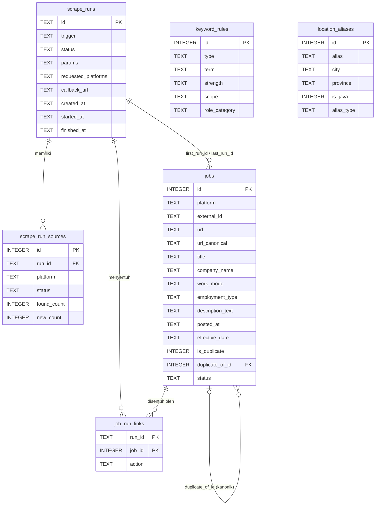
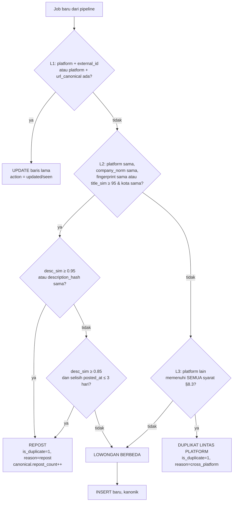

# DATABASE — Job Scraper API

> **Versi:** 1.0 · **Tanggal:** 1 November 2026 · **Engine:** SQLite 3 (≥ 3.35, dengan FTS5)
> **Dokumen terkait:** [`PRD.md`](./PRD.md) · [`ARCHITECTURE.md`](./ARCHITECTURE.md) · [`SCRAPER_SPEC.md`](./SCRAPER_SPEC.md)

Dokumen ini adalah **sumber kebenaran skema data**, aturan skor relevansi, normalisasi lokasi, dan algoritme deduplikasi.

---

## 1. Konvensi dan Konfigurasi SQLite

### 1.1 PRAGMA (dijalankan pada setiap koneksi via event listener SQLAlchemy)

```sql
PRAGMA journal_mode = WAL;
PRAGMA synchronous = NORMAL;
PRAGMA foreign_keys = ON;
PRAGMA busy_timeout = 5000;      -- dari SQLITE_BUSY_TIMEOUT_MS
PRAGMA temp_store = MEMORY;
PRAGMA cache_size = -20000;      -- ±20 MB
```

### 1.2 Konvensi

| Hal | Aturan |
|-----|--------|
| Primary key | `INTEGER PRIMARY KEY AUTOINCREMENT` untuk tabel data; `TEXT` untuk `scrape_runs.id` (`r_YYYYMMDD_HHMMSS_xxxx`) |
| Timestamp | `TEXT` ISO 8601 **UTC** dengan akhiran `Z` (mis. `2026-11-01T02:10:00Z`). Gunakan `TypeDecorator` `UTCDateTime` agar SQLAlchemy selalu mengembalikan `datetime` ber-timezone UTC |
| Tanggal | `TEXT` `YYYY-MM-DD` dalam zona **Asia/Jakarta** (`posted_at`, `expires_at`, `effective_date`) |
| Boolean | `INTEGER` 0/1 dengan `CHECK (col IN (0,1))` |
| JSON | `TEXT` berisi JSON valid (`CHECK (json_valid(col))` bila tidak NULL) |
| Enum | `TEXT` + `CHECK (col IN (...))` |
| Nama kolom | `snake_case` bahasa Inggris di DB; pemetaan ke nama field API (Indonesia) ada di §3.2 |
| Migrasi | Alembic dengan `render_as_batch=True`; objek FTS5 dan trigger dibuat via `op.execute` |

---

## 2. Diagram Relasi (ERD)



`keyword_rules` dan `location_aliases` adalah tabel referensi (tanpa FK ke tabel lain). Tabel virtual `jobs_fts` (FTS5) mencerminkan `jobs` (lihat §9).

---

## 3. Tabel `jobs`

### 3.1 Definisi

```sql
CREATE TABLE jobs (
  id                    INTEGER PRIMARY KEY AUTOINCREMENT,

  -- Identitas sumber
  platform              TEXT NOT NULL CHECK (platform IN
                          ('linkedin','kitalulus','glints','kalibrr','dealls','pintarnya','jobstreet')),
  external_id           TEXT,                       -- ID dari platform; NULL bila tidak tersedia
  url                   TEXT NOT NULL,              -- URL asli sebagaimana diambil
  url_canonical         TEXT NOT NULL,              -- URL ternormalisasi (lihat §8.1)

  -- Inti lowongan
  title                 TEXT NOT NULL,              -- "posisi"
  title_normalized      TEXT NOT NULL,
  company_name          TEXT,                       -- "perusahaan"
  company_normalized    TEXT,

  -- Lokasi
  location_raw          TEXT,                       -- "lokasi" apa adanya
  city                  TEXT,
  province              TEXT,
  is_in_java            INTEGER CHECK (is_in_java IN (0,1)),     -- NULL = tidak diketahui
  is_indonesia          INTEGER CHECK (is_indonesia IN (0,1)),   -- NULL = tidak diketahui
  location_verified     INTEGER NOT NULL DEFAULT 0 CHECK (location_verified IN (0,1)),

  -- Atribut kerja
  work_mode             TEXT NOT NULL DEFAULT 'unknown'
                          CHECK (work_mode IN ('remote','onsite','hybrid','unknown')),
  employment_type       TEXT NOT NULL DEFAULT 'unknown'
                          CHECK (employment_type IN
                          ('fulltime','parttime','contract','freelance','internship','unknown')),

  -- Gaji
  salary_raw            TEXT,                       -- "gaji" apa adanya
  salary_min            INTEGER,                    -- bilangan bulat, satuan mata uang terkecil yang lazim (IDR: rupiah)
  salary_max            INTEGER,
  salary_currency       TEXT,                       -- 'IDR','USD',...
  salary_period         TEXT CHECK (salary_period IN ('hour','day','week','month','year')),

  -- Deskripsi
  description_text      TEXT NOT NULL,              -- teks bersih, LENGKAP
  description_html      TEXT,                       -- opsional (config STORE_HTML)
  description_hash      TEXT NOT NULL,              -- sha1(teks ternormalisasi)
  description_truncated INTEGER NOT NULL DEFAULT 0 CHECK (description_truncated IN (0,1)),

  -- Tanggal
  posted_at             TEXT,                       -- "tanggal_masuk" YYYY-MM-DD (WIB); NULL bila tak diketahui
  posted_at_precision   TEXT NOT NULL DEFAULT 'unknown'
                          CHECK (posted_at_precision IN ('exact','date','relative','unknown')),
  expires_at            TEXT,
  effective_date        TEXT NOT NULL,              -- COALESCE(posted_at, tanggal(first_seen_at WIB)); dijaga aplikasi

  -- Relevansi
  role_category         TEXT CHECK (role_category IN
                          ('frontend','backend','fullstack','software_engineer',
                           'ai_engineer','ai_automation','other_it')),
  matched_keywords      TEXT CHECK (matched_keywords IS NULL OR json_valid(matched_keywords)),  -- JSON array
  relevance_score       INTEGER NOT NULL DEFAULT 0,

  -- Deduplikasi
  fingerprint           TEXT NOT NULL,              -- lihat §8.1
  is_duplicate          INTEGER NOT NULL DEFAULT 0 CHECK (is_duplicate IN (0,1)),
  duplicate_of_id       INTEGER REFERENCES jobs(id) ON DELETE SET NULL,   -- selalu menunjuk KANONIK (tanpa rantai)
  duplicate_reason      TEXT CHECK (duplicate_reason IN ('cross_platform','repost')),
  repost_count          INTEGER NOT NULL DEFAULT 0,

  -- Siklus hidup
  status                TEXT NOT NULL DEFAULT 'active'
                          CHECK (status IN ('active','expired','archived')),
  missed_runs           INTEGER NOT NULL DEFAULT 0,   -- berapa run penuh berturut-turut tidak terlihat
  first_seen_at         TEXT NOT NULL,
  last_seen_at          TEXT NOT NULL,
  detail_fetched_at     TEXT,
  first_run_id          TEXT REFERENCES scrape_runs(id) ON DELETE SET NULL,
  last_run_id           TEXT REFERENCES scrape_runs(id) ON DELETE SET NULL,
  created_at            TEXT NOT NULL,
  updated_at            TEXT NOT NULL,

  -- Debug (default NULL; isi hanya bila STORE_RAW_PAYLOAD=true)
  raw_payload           TEXT CHECK (raw_payload IS NULL OR json_valid(raw_payload)),

  CHECK ( (is_duplicate = 0 AND duplicate_of_id IS NULL) OR (is_duplicate = 1) )
);

-- Keunikan dedup level 1 (§8.2)
CREATE UNIQUE INDEX ux_jobs_platform_external ON jobs(platform, external_id) WHERE external_id IS NOT NULL;
CREATE UNIQUE INDEX ux_jobs_platform_urlcanon ON jobs(platform, url_canonical);

-- Indeks kueri
CREATE INDEX ix_jobs_listing        ON jobs(status, is_duplicate, effective_date DESC);
CREATE INDEX ix_jobs_effective_date ON jobs(effective_date DESC);
CREATE INDEX ix_jobs_first_seen     ON jobs(first_seen_at DESC);
CREATE INDEX ix_jobs_platform       ON jobs(platform, status);
CREATE INDEX ix_jobs_fingerprint    ON jobs(fingerprint);
CREATE INDEX ix_jobs_company_norm   ON jobs(company_normalized);
CREATE INDEX ix_jobs_role           ON jobs(role_category);
CREATE INDEX ix_jobs_province       ON jobs(province);
CREATE INDEX ix_jobs_work_mode      ON jobs(work_mode);
CREATE INDEX ix_jobs_dup_of         ON jobs(duplicate_of_id);
CREATE INDEX ix_jobs_last_run       ON jobs(last_run_id);
```

### 3.2 Pemetaan DB → Field API (PRD §6)

| Field API | Kolom DB | Catatan |
|-----------|----------|---------|
| `id` | `id` | |
| `url` | `url` | |
| `tanggal_masuk` | `posted_at` | Jika NULL, API tetap mengembalikan `null` (usia dihitung dari `effective_date`) |
| `tanggal_masuk_presisi` | `posted_at_precision` | |
| `sumber` | `platform` | |
| `external_id` | `external_id` | |
| `perusahaan` | `company_name` | |
| `posisi` | `title` | |
| `lokasi` | `location_raw` | |
| `kota`, `provinsi` | `city`, `province` | |
| `sistem_kerja` | `work_mode` | |
| `tipe_kerja` | `employment_type` | |
| `gaji` | `salary_raw` | |
| `gaji_min/max/mata_uang/periode` | `salary_min/max/currency/period` | |
| `deskripsi` | `description_text` | Selalu lengkap |
| `kategori_peran` | `role_category` | |
| `kata_kunci_cocok` | `matched_keywords` | Di-decode ke array |
| `skor_relevansi` | `relevance_score` | |
| `is_duplikat`, `duplikat_dari_id` | `is_duplicate`, `duplicate_of_id` | |
| `pertama_dilihat`, `terakhir_dilihat` | `first_seen_at`, `last_seen_at` | |
| `status` | `status` | |
| `sumber_lain` (detail saja, SEBAIKNYA) | turunan | `[{sumber, url}]` dari baris duplikat yang menunjuk ke kanonik ini |

### 3.3 Aturan Upsert

- **Insert baru:** isi semua kolom; `first_seen_at = last_seen_at = created_at = updated_at = now`; `first_run_id = last_run_id = run_id`; `missed_runs = 0`.
- **Update (lowongan yang sama terlihat lagi):**
  - Selalu: `last_seen_at`, `last_run_id`, `missed_runs = 0`, `updated_at`.
  - Jika `fetch_detail` dijalankan: perbarui `description_*`, `description_hash`, `salary_*`, `work_mode`, `employment_type`, `detail_fetched_at`, hitung ulang klasifikasi.
  - **Jangan** menimpa nilai yang sudah ada dengan `NULL`/`unknown` dari hasil scrape yang lebih miskin (mis. gaji yang sebelumnya terbaca). Gunakan "coalesce, prefer richer".
  - `posted_at`: hanya diperbarui bila presisi baru **lebih baik** (`exact` > `date` > `relative` > `unknown`). Jangan biarkan tanggal relatif menggeser tanggal yang sudah eksak.
  - Jika status sebelumnya `expired` dan lowongan terlihat lagi → kembali `active`.
- **Setiap upsert** menulis satu baris `job_run_links` (§5).

---

## 4. Tabel `scrape_runs` dan `scrape_run_sources`

```sql
CREATE TABLE scrape_runs (
  id                  TEXT PRIMARY KEY,                 -- r_20261101_021000_ab12
  trigger             TEXT NOT NULL CHECK (trigger IN ('api','schedule')),
  status              TEXT NOT NULL CHECK (status IN
                        ('queued','running','completed','partial','failed','cancelled')),
  requested_platforms TEXT NOT NULL CHECK (json_valid(requested_platforms)),   -- ["glints",...]
  params              TEXT NOT NULL CHECK (json_valid(params)),                -- keywords, max_age_days, ...
  callback_url        TEXT,
  callback_status     TEXT CHECK (callback_status IN ('pending','sent','failed')),
  found_count         INTEGER NOT NULL DEFAULT 0,
  new_count           INTEGER NOT NULL DEFAULT 0,
  updated_count       INTEGER NOT NULL DEFAULT 0,
  duplicate_count     INTEGER NOT NULL DEFAULT 0,
  filtered_keyword    INTEGER NOT NULL DEFAULT 0,
  filtered_location   INTEGER NOT NULL DEFAULT 0,
  filtered_age        INTEGER NOT NULL DEFAULT 0,
  error               TEXT,
  created_at          TEXT NOT NULL,
  started_at          TEXT,
  finished_at         TEXT
);
CREATE INDEX ix_runs_created ON scrape_runs(created_at DESC);
CREATE INDEX ix_runs_status  ON scrape_runs(status);

CREATE TABLE scrape_run_sources (
  id                  INTEGER PRIMARY KEY AUTOINCREMENT,
  run_id              TEXT NOT NULL REFERENCES scrape_runs(id) ON DELETE CASCADE,
  platform            TEXT NOT NULL,
  status              TEXT NOT NULL CHECK (status IN
                        ('queued','running','completed','degraded','blocked',
                         'auth_required','failed','skipped','cancelled')),
  search_terms        TEXT CHECK (search_terms IS NULL OR json_valid(search_terms)),
  pages_visited       INTEGER NOT NULL DEFAULT 0,
  found_count         INTEGER NOT NULL DEFAULT 0,       -- listing yang ditemukan
  detail_fetched      INTEGER NOT NULL DEFAULT 0,
  new_count           INTEGER NOT NULL DEFAULT 0,
  updated_count       INTEGER NOT NULL DEFAULT 0,
  duplicate_count     INTEGER NOT NULL DEFAULT 0,
  filtered_keyword    INTEGER NOT NULL DEFAULT 0,
  filtered_location   INTEGER NOT NULL DEFAULT 0,
  filtered_age        INTEGER NOT NULL DEFAULT 0,
  error_count         INTEGER NOT NULL DEFAULT 0,
  errors              TEXT CHECK (errors IS NULL OR json_valid(errors)),   -- [{code,message,url?,at}] maks 50 entri
  started_at          TEXT,
  finished_at         TEXT,
  UNIQUE (run_id, platform)
);
CREATE INDEX ix_run_sources_platform ON scrape_run_sources(platform, finished_at DESC);
```

Total pada `scrape_runs` adalah penjumlahan dari `scrape_run_sources` (dihitung saat run selesai dan diperbarui berkala).

---

## 5. Tabel `job_run_links`

Menyimpan lowongan mana yang tersentuh oleh run mana. Dipakai oleh `GET /jobs?run_id=…&only_new=true`.

```sql
CREATE TABLE job_run_links (
  run_id  TEXT    NOT NULL REFERENCES scrape_runs(id) ON DELETE CASCADE,
  job_id  INTEGER NOT NULL REFERENCES jobs(id)        ON DELETE CASCADE,
  action  TEXT    NOT NULL CHECK (action IN ('new','updated','seen','duplicate','repost')),
  PRIMARY KEY (run_id, job_id)
);
CREATE INDEX ix_jrl_job ON job_run_links(job_id);
```

- `new` — baris dibuat pada run ini. `only_new=true` ⇒ `action = 'new'` **dan** `jobs.is_duplicate = 0` (kecuali `include_duplicates=true`).
- `updated` — detail diperbarui. `seen` — hanya `last_seen_at` disentuh.
- `duplicate`/`repost` — baris baru dibuat namun ditandai duplikat.
- Kebijakan retensi: hapus link untuk run > 90 hari (skrip pembersihan).

---

## 6. Tabel `keyword_rules` (aturan kata kunci)

### 6.1 Definisi

```sql
CREATE TABLE keyword_rules (
  id             INTEGER PRIMARY KEY AUTOINCREMENT,
  type           TEXT NOT NULL CHECK (type IN ('include','exclude','search_term')),
  term           TEXT NOT NULL,                       -- disimpan lowercase
  strength       TEXT CHECK (strength IN ('strong','weak')),   -- wajib untuk type='include', NULL untuk lainnya
  scope          TEXT NOT NULL DEFAULT 'both' CHECK (scope IN ('title','description','both')),
  role_category  TEXT CHECK (role_category IN
                   ('frontend','backend','fullstack','software_engineer',
                    'ai_engineer','ai_automation','other_it')),
  is_regex       INTEGER NOT NULL DEFAULT 0 CHECK (is_regex IN (0,1)),
  is_active      INTEGER NOT NULL DEFAULT 1 CHECK (is_active IN (0,1)),
  source         TEXT NOT NULL DEFAULT 'user' CHECK (source IN ('seed','user')),
  created_at     TEXT NOT NULL,
  updated_at     TEXT NOT NULL,
  CHECK ( (type = 'include' AND strength IS NOT NULL) OR (type <> 'include') )
);
CREATE UNIQUE INDEX ux_keyword_rules ON keyword_rules(type, term, scope);
CREATE INDEX ix_keyword_rules_active ON keyword_rules(type, is_active);
```

**Aturan pencocokan:** teks dan `term` dinormalisasi (lowercase, `-`/`_` → spasi, spasi berlebih dirapikan). Pencocokan memakai **batas kata** (`\b`) kecuali `is_regex=1`. `term` yang mengandung spasi cocok dengan spasi/tanda hubung fleksibel (`back end`, `back-end`, `backend` diperlakukan oleh seed sebagai tiga aturan terpisah agar eksplisit dan mudah diuji).

### 6.2 Seed Awal (`config/keywords.yaml`)

**`search_term`** (dikirim ke kotak pencarian platform; urutan = prioritas bila dibatasi `search_terms_limit`):

`software engineer`, `backend developer`, `frontend developer`, `fullstack developer`, `web developer`, `programmer`, `ai engineer`, `machine learning engineer`, `ai automation`, `automation engineer`, `n8n`, `python developer`, `llm engineer`, `software developer`

**`include` — strong** (`scope=both` kecuali disebut lain):

| term | role_category |
|------|---------------|
| `software engineer`, `software developer` | `software_engineer` |
| `programmer`, `pemrogram`, `web developer` | `software_engineer` |
| `backend`, `back-end`, `back end` | `backend` |
| `frontend`, `front-end`, `front end` | `frontend` |
| `fullstack`, `full-stack`, `full stack` | `fullstack` |
| `ai engineer`, `ai developer`, `artificial intelligence`, `machine learning`, `ml engineer`, `llm`, `generative ai`, `genai`, `nlp`, `prompt engineer`, `ai agent` | `ai_engineer` |
| `ai automation`, `automation engineer`, `n8n`, `workflow automation` | `ai_automation` |

**`include` — weak** (hanya sah bila cocok di judul, word-boundary; di deskripsi memberi bobot kecil):

`it`, `web`, `developer`, `informatika`, `teknik informatika`, `ilmu komputer`, `software`

**`exclude`** (`scope=title`; kecuali disebut lain):

`it support`, `helpdesk`, `help desk`, `technical support`, `customer service`, `customer support`, `sales`, `marketing`, `digital marketing`, `seo`, `admin`, `administrasi`, `data entry`, `graphic designer`, `web designer`, `ui/ux designer`, `ui ux designer`, `business developer`, `business development`, `business analyst`, `project manager`, `product manager`, `auditor`, `accountant`, `akuntan`, `teknisi`, `technician`, `network engineer`, `jaringan`, `recruiter`, `content writer`, `content creator`, `social media`, `driver`, `kasir`

> Seed hanyalah titik awal. Pemilik dapat menambah/ubah lewat `/api/v1/keywords`. Seed idempoten: `loader.py` menyisipkan hanya yang belum ada berdasarkan `(type, term, scope)`, tidak menimpa baris `source='user'`.

### 6.3 Rumus Skor Relevansi dan Keputusan

Misalkan `T` = judul ternormalisasi, `D` = deskripsi ternormalisasi.

```text
title_component =
    100 jika ada ≥1 include STRONG cocok di T
    ditambah 10 untuk setiap include STRONG TAMBAHAN yang berbeda di T (maks +30)
  atau 40 jika hanya include WEAK yang cocok di T
  atau 0

desc_component =
    min(75, 25 × jumlah include STRONG berbeda yang cocok di D)
  + min(10,  5 × jumlah include WEAK berbeda yang cocok di D)

desc_penalty = min(45, 15 × jumlah exclude berbeda (scope description/both) yang cocok di D)

skor_relevansi = title_component + desc_component − desc_penalty
```

**Keputusan:**

1. Jika ada `exclude` (scope `title`/`both`) cocok di `T` → **TOLAK** (alasan `keyword`). Deskripsi tidak dipertimbangkan.
2. Jika `title_component > 0` → **TERIMA**.
3. Jika tidak, `skor_relevansi ≥ RELEVANCE_THRESHOLD` (default 50, artinya ≥ 2 include strong berbeda di deskripsi tanpa penalti besar) → **TERIMA**.
4. Selain itu → **TOLAK** (alasan `keyword`).

**`role_category`** ditentukan dari `role_category` aturan yang cocok (prioritas **judul** di atas deskripsi). Bila beberapa kategori cocok, pilih berdasarkan urutan:

1. `ai_automation` → 2. `ai_engineer` → 3. `fullstack` → 4. gabungan `frontend` + `backend` yang sama-sama cocok ⇒ `fullstack` → 5. `backend` → 6. `frontend` → 7. `software_engineer` → 8. `other_it` (hanya cocok weak/deskripsi saja tanpa kategori).

`matched_keywords` = daftar `term` unik yang cocok (judul lebih dulu), maksimum 20.

---

## 7. Tabel `location_aliases`

### 7.1 Definisi

```sql
CREATE TABLE location_aliases (
  id          INTEGER PRIMARY KEY AUTOINCREMENT,
  alias       TEXT NOT NULL,        -- lowercase, tanpa awalan "kota/kab./kabupaten"
  alias_type  TEXT NOT NULL CHECK (alias_type IN
                ('city','province','region','country_id','country_foreign','remote_word')),
  city        TEXT,                 -- nama kanonik (NULL untuk province/region/country)
  province    TEXT,                 -- nama kanonik provinsi (NULL untuk country)
  is_java     INTEGER CHECK (is_java IN (0,1)),   -- NULL untuk country/remote_word
  UNIQUE (alias, alias_type)
);
CREATE INDEX ix_loc_alias ON location_aliases(alias);
```

### 7.2 Seed (`config/locations_java.yaml`)

**Provinsi Jawa (`is_java=1`):** `DKI Jakarta`, `Jawa Barat`, `Banten`, `Jawa Tengah`, `DI Yogyakarta`, `Jawa Timur`.

Alias provinsi: `dki jakarta`, `jakarta`, `jabodetabek` (region → DKI Jakarta/`city=NULL`), `jabar`, `west java`, `jawa barat`, `banten`, `jateng`, `central java`, `jawa tengah`, `diy`, `di yogyakarta`, `daerah istimewa yogyakarta`, `special region of yogyakarta`, `jatim`, `east java`, `jawa timur`.

**Kota/kabupaten utama (minimal, perluas sesuai temuan discovery):**

| Provinsi | Kota/Kabupaten (alias lain dalam kurung) |
|----------|-------------------------------------------|
| DKI Jakarta | Jakarta Pusat, Jakarta Utara, Jakarta Barat, Jakarta Selatan, Jakarta Timur, Kepulauan Seribu (alias: `south jakarta`, `jakarta raya`, `greater jakarta`) |
| Banten | Tangerang, Tangerang Selatan (`tangsel`, `south tangerang`), Serang, Cilegon, Lebak, Pandeglang (alias BSD, Serpong, Alam Sutera, Gading Serpong → Tangerang/Tangerang Selatan) |
| Jawa Barat | Bandung, Bandung Barat, Cimahi, Bekasi, Depok, Bogor, Sukabumi, Cirebon, Karawang, Purwakarta, Subang, Garut, Tasikmalaya, Cianjur, Sumedang, Indramayu, Kuningan, Majalengka, Banjar, Pangandaran (alias Cikarang, Cibubur → Bekasi/Bogor sesuai wilayah) |
| Jawa Tengah | Semarang, Surakarta (`solo`), Salatiga, Magelang, Pekalongan, Tegal, Kudus, Jepara, Demak, Klaten, Boyolali, Sukoharjo, Karanganyar, Purwokerto (`banyumas`), Cilacap, Kendal, Batang, Pati |
| DI Yogyakarta | Yogyakarta (`jogja`, `yogya`), Sleman, Bantul, Kulon Progo, Gunungkidul |
| Jawa Timur | Surabaya, Sidoarjo, Gresik, Malang, Batu, Kediri, Mojokerto, Pasuruan, Probolinggo, Jember, Banyuwangi, Madiun, Blitar, Lamongan, Jombang, Tuban |

**Provinsi/kota di luar Jawa (`is_java=0`)** — wajib ada agar penolakan eksplisit (bukan "tidak diketahui"): seluruh 28+ provinsi lain (Aceh, Sumatera Utara/Barat/Selatan, Riau, Kepulauan Riau, Jambi, Bengkulu, Lampung, Bangka Belitung, Bali, NTB, NTT, Kalimantan *, Sulawesi *, Maluku, Maluku Utara, Papua *) beserta kota besar: Medan, Padang, Pekanbaru, Batam, Palembang, Bandar Lampung, Denpasar, Mataram, Kupang, Pontianak, Banjarmasin, Balikpapan, Samarinda, Makassar, Manado, Ambon, Jayapura, Banda Aceh, Jambi, Bengkulu, Bontang, Palangka Raya, Gorontalo, Kendari, Palu, Ternate, Sorong.

**`country_id`:** `indonesia`, `id`, `republik indonesia`.
**`country_foreign`:** `singapore`, `malaysia`, `philippines`, `vietnam`, `thailand`, `united states`, `usa`, `united kingdom`, `india`, `australia`, `japan`, `china`, `hong kong`, `taiwan`, `germany`, `netherlands`, `uae`, `united arab emirates`, `worldwide`, `anywhere` *(catatan: `worldwide/anywhere` diperlakukan sebagai asing untuk BR-03 kecuali disertai kata `indonesia`)*.
**`remote_word`:** `remote`, `work from home`, `wfh`, `anywhere in indonesia`, `seluruh indonesia`.

### 7.3 Algoritme Normalisasi Lokasi (`pipeline/location.py`)

1. Lowercase; buang awalan `kota `, `kab.`, `kabupaten `, `kec.`, dan akhiran seperti `, indonesia`.
2. Pecah `location_raw` dengan pemisah `, | / – - ;` dan kata `area`, `greater`, `region`, `metropolitan` dibuang dari token.
3. Cari alias dari token **terpanjang ke terpendek** (`jakarta selatan` sebelum `jakarta`); simpan semua kecocokan.
4. Tentukan hasil:
   - Ada kecocokan `city` → `city`, `province`, `is_java` dari baris itu. `location_verified=1`.
   - Hanya `province`/`region` → `province`, `city=NULL`, `is_java` dari provinsi. `location_verified=1`.
   - Hanya `country_id` → `is_indonesia=1`, `is_java=NULL`, `location_verified=0`.
   - `country_foreign` → `is_indonesia=0`.
   - Tidak ada kecocokan → semua NULL, `location_verified=0`.
5. Untuk lokasi multi-kota (mis. "Jakarta, Bandung, Surabaya"): bila **salah satu** berada di Jawa → `is_in_java=1`, `city` = kota pertama yang cocok di Jawa.
6. `is_indonesia`: 1 bila ada kecocokan `city`/`province`/`country_id`; 0 bila `country_foreign` tanpa `country_id`/kota Indonesia; selain itu NULL.

### 7.4 Tabel Keputusan Lokasi (BR-02, BR-03)

| `work_mode` | Hasil lokasi | Keputusan |
|-------------|--------------|-----------|
| `onsite` / `hybrid` | `is_in_java = 1` | **Terima** |
| `onsite` / `hybrid` | `is_in_java = 0` | Tolak (`location`) |
| `onsite` / `hybrid` / `unknown` | `is_in_java IS NULL`, `is_indonesia = 0` | Tolak (`location`) |
| `onsite` / `hybrid` / `unknown` | `is_in_java IS NULL` (tidak diketahui) | Terima + `location_verified=0` bila `KEEP_UNVERIFIED_LOCATION=true`, selain itu tolak |
| `unknown` | `is_in_java = 1` | Terima |
| `unknown` | `is_in_java = 0` | Tolak |
| `remote` | `is_indonesia = 1` atau NULL (lokasi kosong/`remote`/`Indonesia`/kota Indonesia mana pun) | **Terima** |
| `remote` | `is_indonesia = 0` (negara asing eksplisit) | Tolak (`location`) |

---

## 8. Deduplikasi

### 8.1 Normalisasi untuk Dedup

**`url_canonical`:** lowercase skema+host; hapus `www.`; hapus fragment; hapus parameter pelacak (`utm_*`, `ref`, `refId`, `trackingId`, `trk`, `src`, `source`, `fbclid`, `gclid`, `lipi`, `position`, `pageNum`, `currentJobId` bila tidak dipakai sebagai ID); urutkan query yang tersisa; hapus `/` penutup. Khusus per platform ada aturan tambahan di SCRAPER_SPEC (mis. LinkedIn: `https://www.linkedin.com/jobs/view/<id>`).

**`company_normalized`:** lowercase → hapus tanda baca → buang token badan usaha di awal/akhir (`pt`, `cv`, `tbk`, `persero`, `ltd`, `limited`, `inc`, `corp`, `co`, `pte`, `sdn`, `bhd`, `llc`, `gmbh`) → rapikan spasi. Contoh: `PT. Bukalapak.com Tbk` → `bukalapak com`.

**`title_normalized`:** lowercase → buang isi kurung/bracket yang berupa lokasi/status (`(remote)`, `[urgent]`) → buang kata promosi (`urgent`, `dibutuhkan`, `hiring`, `we are hiring`, `open recruitment`, `lowongan`, `walk in`) → seragamkan (`back end|back-end`→`backend`, `front end|front-end`→`frontend`, `full stack|full-stack`→`fullstack`, `sr.|sr`→`senior`, `jr.|jr`→`junior`, `dev`→`developer`, `engr`→`engineer`) → buang sufiks lokasi setelah ` - `/` | ` bila cocok alias lokasi → rapikan spasi.

**`seniority_tokens`** (turunan, tidak disimpan): himpunan dari `{intern, junior, mid, senior, lead, principal, staff, head, manager}` yang muncul pada judul (`magang`→`intern`, `associate`→`junior`).

**`tech_tokens`** (turunan): himpunan teknologi yang muncul pada judul dari kamus (`python, java, golang, go, php, laravel, node, nodejs, react, vue, angular, nextjs, dotnet, .net, csharp, flutter, kotlin, swift, ruby, rails, rust, django, fastapi, spring, typescript, javascript`).

**`fingerprint`** = `sha1(company_normalized + '|' + title_normalized + '|' + (city_lower | 'remote' | province_lower | ''))`.

**`description_hash`** = `sha1` dari teks deskripsi ternormalisasi (lowercase, tanpa tanda baca, spasi dirapikan).

**`desc_sim(a, b)`** = `rapidfuzz.fuzz.token_sort_ratio(a[:2000], b[:2000]) / 100` pada teks ternormalisasi.

**`title_sim(a, b)`** = `rapidfuzz.fuzz.token_set_ratio(title_normalized_a, title_normalized_b)` (0–100).

### 8.2 Tiga Level



**Level 1 — identik pada platform yang sama.** Urutan pencarian: `(platform, external_id)` bila ada, lalu `(platform, url_canonical)`. Ditegakkan juga oleh unique index. Hasil: **update**, bukan insert.

**Level 2 — posting ulang pada platform yang sama** (ID/URL berbeda). Kandidat: `platform` sama **dan** `company_normalized` sama **dan** (`fingerprint` sama **atau** `title_sim ≥ 95` dengan kota sama). Lalu putuskan seperti diagram. Kandidat yang `seniority_tokens`, `tech_tokens`, atau `employment_type` berbeda **tidak** pernah dianggap repost (BR-06).

**Level 3 — lintas platform.** Lihat §8.3.

### 8.3 Syarat Duplikat Lintas Platform (SEMUA harus terpenuhi)

| # | Syarat | Detail |
|---|--------|--------|
| 1 | Platform berbeda | |
| 2 | Perusahaan sama | `company_normalized` identik **atau** `fuzz.ratio ≥ 92`. Jika salah satu perusahaan kosong → lihat "mode ketat" di bawah |
| 3 | Judul mirip | `title_sim ≥ 90` |
| 4 | Senioritas sama | `seniority_tokens` kedua sisi identik (kosong = kosong) |
| 5 | Teknologi kompatibel | Bila kedua sisi punya `tech_tokens` non-kosong → harus identik. Bila salah satu kosong → lolos |
| 6 | Tipe kerja kompatibel | Sama, atau salah satu `unknown` |
| 7 | Lokasi kompatibel | Kota sama; atau keduanya `remote`; atau salah satu kota NULL dengan provinsi sama; `remote` vs `onsite` = **tidak** kompatibel |
| 8 | Rentang waktu | `|posted_at_A − posted_at_B| ≤ 21 hari` (diabaikan bila salah satu NULL) |
| 9 | Deskripsi mirip | `desc_sim ≥ 0.80` |

**Mode ketat** (perusahaan kosong di salah satu sisi, mis. perusahaan dirahasiakan): wajib `title_sim ≥ 95` **dan** `desc_sim ≥ 0.90` **dan** lokasi identik; jika tidak → bukan duplikat.

**Pemilihan kanonik** di antara kelompok duplikat (urutan tie-break): `posted_at` paling awal (non-NULL didahulukan) → memiliki gaji → deskripsi lebih panjang → urutan prioritas sumber (`SOURCE_PRIORITY`, default: `jobstreet, glints, linkedin, kalibrr, dealls, kitalulus, pintarnya`).
- Baris baru yang cocok dengan kanonik yang ada → baris baru disimpan sebagai duplikat (`duplicate_of_id = kanonik.id`).
- `duplicate_of_id` **tidak boleh membentuk rantai**: bila kanonik itu sendiri duplikat, ikuti ke akarnya. Tidak ada penukaran kanonik otomatis pada v1.0.
- Baris duplikat **tidak dihapus**; API menyembunyikannya secara default.

### 8.4 Matriks Kasus Uji Wajib (`tests/unit/test_deduper.py`)

| # | Kasus | Hasil yang diharapkan |
|---|-------|-----------------------|
| 1 | Scrape ulang lowongan Glints yang sama (external_id sama) | Update; tidak ada baris baru |
| 2 | URL sama dengan parameter `utm_source` berbeda | Update (URL kanonik sama) |
| 3 | JobStreet & LinkedIn: perusahaan sama, judul `Backend Engineer` vs `Backend Engineer (Python)`, Jakarta Selatan, deskripsi 90% mirip | Duplikat lintas platform |
| 4 | Perusahaan sama, judul sama, **Bandung** vs **Surabaya** | Berbeda |
| 5 | Judul `Senior Backend Developer` vs `Junior Backend Developer`, perusahaan sama | Berbeda |
| 6 | `Backend Developer (Go)` vs `Backend Developer (Java)` | Berbeda |
| 7 | Glints: perusahaan sama, judul sama, ID berbeda, deskripsi identik, selisih posting 12 hari | Repost (`duplicate_reason=repost`, `repost_count+1`) |
| 8 | Perusahaan sama, judul sama, deskripsi hanya 55% mirip (dua tim berbeda) | Berbeda |
| 9 | Fulltime vs Magang, judul & perusahaan sama | Berbeda |
| 10 | Perusahaan dirahasiakan di satu sisi, judul sama persis, deskripsi 92% | Duplikat (mode ketat) |
| 11 | Perusahaan dirahasiakan, judul sama, deskripsi 82% | Berbeda (mode ketat tidak terpenuhi) |
| 12 | `PT Maju Jaya Tbk` vs `Maju Jaya` | Perusahaan dianggap sama |
| 13 | Remote vs Onsite Jakarta, judul & perusahaan sama | Berbeda |
| 14 | Rantai: C cocok dengan B (duplikat A) | `C.duplicate_of_id = A.id` |

---

## 9. Pencarian Teks (FTS5)

```sql
CREATE VIRTUAL TABLE jobs_fts USING fts5(
  title, company_name, description_text,
  content='jobs', content_rowid='id',
  tokenize = 'unicode61 remove_diacritics 2'
);

CREATE TRIGGER jobs_ai AFTER INSERT ON jobs BEGIN
  INSERT INTO jobs_fts(rowid, title, company_name, description_text)
  VALUES (new.id, new.title, new.company_name, new.description_text);
END;
CREATE TRIGGER jobs_ad AFTER DELETE ON jobs BEGIN
  INSERT INTO jobs_fts(jobs_fts, rowid, title, company_name, description_text)
  VALUES ('delete', old.id, old.title, old.company_name, old.description_text);
END;
CREATE TRIGGER jobs_au AFTER UPDATE OF title, company_name, description_text ON jobs BEGIN
  INSERT INTO jobs_fts(jobs_fts, rowid, title, company_name, description_text)
  VALUES ('delete', old.id, old.title, old.company_name, old.description_text);
  INSERT INTO jobs_fts(rowid, title, company_name, description_text)
  VALUES (new.id, new.title, new.company_name, new.description_text);
END;
```

**Kueri `q`:** bersihkan input pengguna (hapus karakter operator FTS seperti `"`, `*`, `:`, `(`, `)`, `-` di awal), pecah menjadi token, bungkus tiap token dengan tanda kutip ganda dan tambahkan awalan `*`, gabung dengan `AND`. Urutkan dengan `bm25(jobs_fts, 10.0, 3.0, 1.0)` bila `sort` tidak ditentukan secara eksplisit. Jika modul FTS5 tidak tersedia saat start, fallback ke `LIKE '%token%'` pada `title`, `company_name`, `description_text` dan catat peringatan di log.

**Indeks ulang:** perintah `INSERT INTO jobs_fts(jobs_fts) VALUES('rebuild');` disediakan pada `scripts/` untuk pemulihan.

---

## 10. Siklus Hidup, Retensi, dan Backup

### 10.1 Status `expired`

Setelah setiap sub-run platform berstatus `completed` **dan** dijalankan dengan kata kunci default (bukan override) **dan** tanpa `max_jobs_per_platform` yang memotong hasil:
- Untuk lowongan `active` platform itu yang **tidak** tersentuh pada run ini dan `effective_date` masih dalam jangkauan `max_age_days` run: `missed_runs += 1`.
- Bila `missed_runs ≥ 3` **dan** `effective_date` lebih tua dari `DEFAULT_MAX_AGE_DAYS` → `status = 'expired'`.
- Jika platform menandai kedaluwarsa pada halaman detail (`expires_at` terlewat/ teks "lowongan ditutup") → langsung `expired`.

### 10.2 Retensi (skrip opsional `scripts/prune.py`)

- Hapus `job_run_links` untuk run > 90 hari.
- Hapus `jobs` berstatus `expired` dengan `effective_date` > 180 hari (opsi `--include-archived`).
- Jalankan `VACUUM` setelah penghapusan besar.

### 10.3 Backup

`scripts/backup_db.sh` memakai `sqlite3 data/jobs.db ".backup 'data/backup/jobs_YYYYMMDD.db'"` (aman saat WAL aktif), menyimpan 7 salinan terakhir.

---

## 11. Contoh Kueri Referensi

```sql
-- Daftar untuk n8n: lowongan baru pada run tertentu, tanpa duplikat
SELECT j.* FROM jobs j
JOIN job_run_links l ON l.job_id = j.id
WHERE l.run_id = :run_id AND l.action = 'new'
  AND j.is_duplicate = 0 AND j.status = 'active'
ORDER BY j.effective_date DESC, j.relevance_score DESC
LIMIT :limit OFFSET :offset;

-- Filter usia: maksimal 7 hari (WIB)
SELECT * FROM jobs
WHERE status = 'active' AND is_duplicate = 0
  AND effective_date >= date('now', '+7 hours', '-7 days');

-- Pencarian teks + filter
SELECT j.* FROM jobs j
JOIN jobs_fts f ON f.rowid = j.id
WHERE jobs_fts MATCH :fts_query
  AND j.platform IN ('glints','jobstreet')
  AND j.work_mode IN ('remote','hybrid')
  AND j.is_duplicate = 0
ORDER BY bm25(jobs_fts, 10.0, 3.0, 1.0)
LIMIT 50;

-- Lowongan kanonik beserta sumber lain
SELECT c.id, c.title, c.platform, d.platform AS other_platform, d.url AS other_url
FROM jobs c JOIN jobs d ON d.duplicate_of_id = c.id
WHERE c.id = :id;

-- Statistik per platform
SELECT platform, COUNT(*) total,
       SUM(is_duplicate = 0 AND status = 'active') aktif
FROM jobs GROUP BY platform;
```
